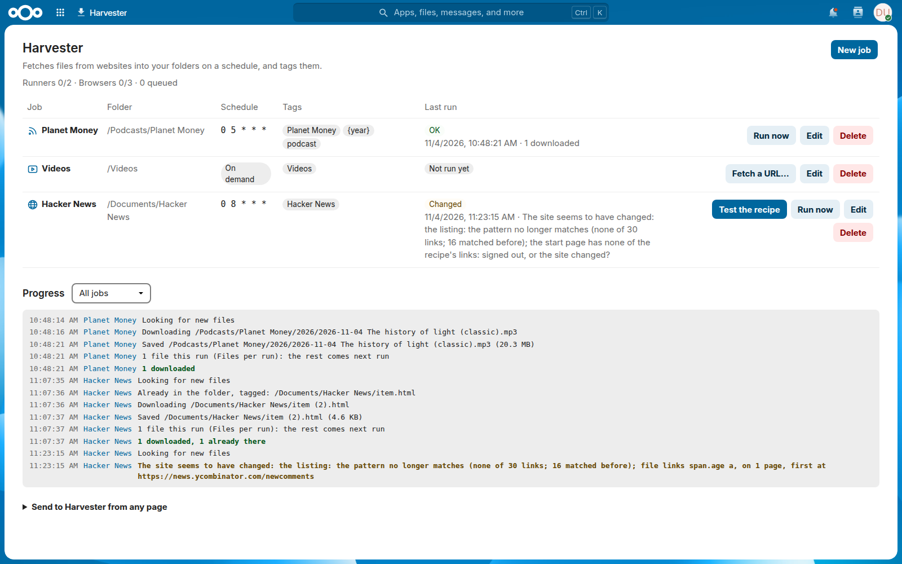
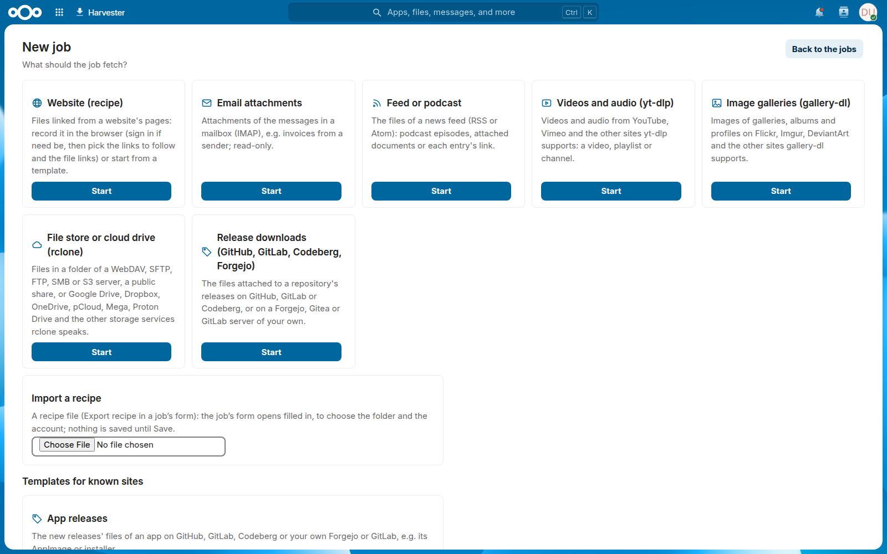
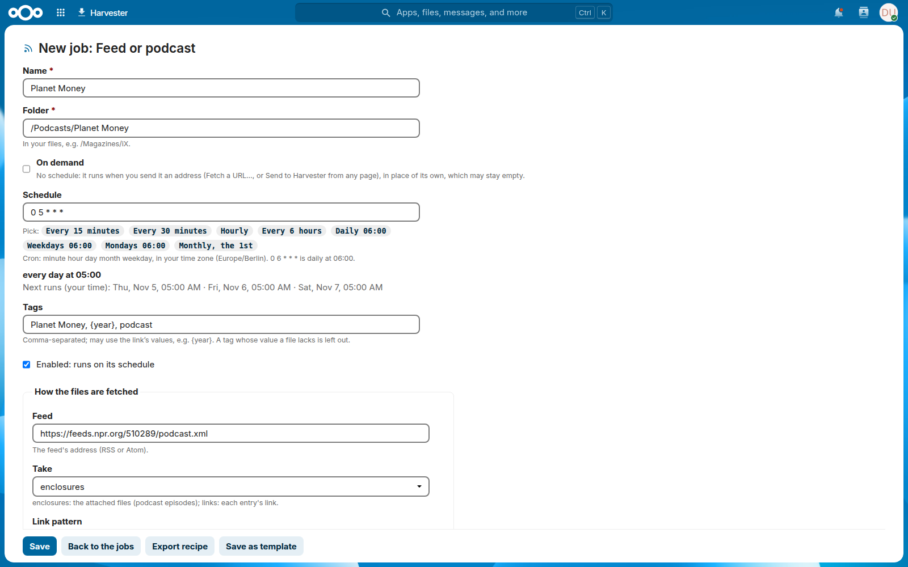
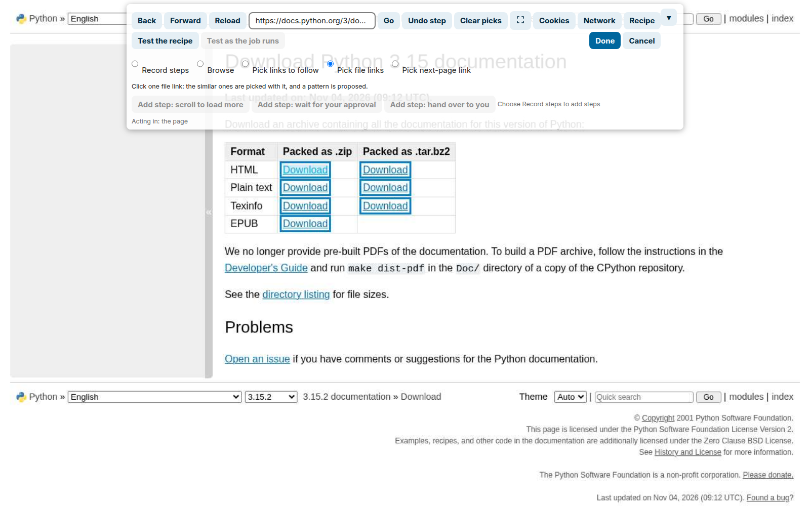

# Harvester

A Nextcloud External App (AppAPI, Python) that fetches files into your folders on a schedule
and tags them: from websites, mailboxes, feeds, video and gallery sites, file stores and cloud
drives, and release pages. It is generic: a website is described by a **recipe**, recorded in
the app's browser or taken from a template, not by code.

- **Jobs:** a source, a folder, a schedule in your time zone (or *On demand*: it fetches the
  addresses you send it), tags and an account; a progress log of what the runs do.
- **Sources:** websites by a recipe, mailbox attachments (IMAP), feeds and podcasts, videos and
  audio (yt-dlp), galleries (gallery-dl), file stores and cloud drives (rclone), release
  downloads (GitHub, GitLab, Codeberg, Forgejo, Gitea).
- **Choices:** one recipe for every account or contract, every year, every child: the steps
  after a choice and the listing are gone through for each option of a list.
- **Exports prepared first:** after *Create export*, a job waits (reloading if asked) until the
  file's link or a ready entry shows, then downloads it.
- **Pages as files:** what a site offers as no file of its own: pages saved as PDF, HTML (one
  file) or Markdown (the main text), such as receipts and articles, also a page you send it; the
  PDFs and pictures a page only shows (a viewer, an `<embed>`, a `blob:`); pictures at their
  full size.
- **Versions and duplicates:** a file whose content the job saved already from another address
  is not saved again; a known file that changed (asked cheaply with `ETag` and `Last-Modified`) is
  saved over its own, and Nextcloud keeps the one before as a version.
- **ZIP files unpacked** into a folder of their name, if asked, with guards against paths out
  of the folder, links and zip bombs.
- **Pages watched:** a page (or a part of it) compared with the last run's text, a change told
  in a notification with an excerpt; whitespace alone is no change.
- **Cookie banners** answered on their own, "Reject all" else "Only necessary": the common consent
  managers' and banners of such buttons in German, English and Polish, nothing else.
- **Recorder:** a browser in the app, shown on the page: sign in and pick the links (or the
  buttons, rows and cards without an address, which the job clicks, or a listing the page asks
  for as JSON, also with POST and GraphQL), and the app proposes their patterns, the files' names
  and tags; *Test the recipe* shows what a run would find.
- **Templates** for known sites (heise's magazines, podcasts, channels, galleries, releases, a
  page saved on demand), and recipes to export and import as files.
- **Sign-ins:** passwords, one-time codes, codes by e-mail, cookies, OAuth2 for mail; kept
  sessions; a code from your phone (an SMS), typed on the jobs page while the run waits, or an
  approval in an app; when a site asks for a person (or a passkey), the job waits for you in its
  browser.
- **Languages:** English, German and Polish: the page (also the progress log and the schedule
  in words), the admin's settings and the notifications follow each person's language in
  Nextcloud (others are English).
- **Careful with sites and with the server:** one job per site at a time, the pauses a site asks
  for, files fetched once; the browsers and downloads reach only public addresses.

## Screenshots

|                                                          |                                                                   |
| -------------------------------------------------------- | ----------------------------------------------------------------- |
|  |  |
|                    |     |

## Requirements

- Nextcloud 32 to 36 with AppAPI and a deploy daemon (HaRP: the recorder's WebSocket goes
  through it).
- Memory for the browsers: each takes some 300-600 MB, up to `HARVESTER_BROWSERS` (3 by default)
  at once.

## Installing

Register the app with AppAPI on a deploy daemon: its image is `ghcr.io/sarumaj/harvester`, as
`appinfo/info.xml` names it (also on Forgejo's registry). Then set the numbers of jobs and
browsers, the proxy and the network guard under *Administration settings > Additional settings >
Harvester*. The [administrator's guide](docs/admin.md) has the details: the registry, the
settings, the proxy, the guard, disguise and impersonation, and the backup.

## Using it

*Harvester* in Nextcloud's top menu lists your jobs. **New job** offers a card per source and per
template: fill in the form (a folder, a schedule, tags, the account), or for a website record
its recipe in the app's browser, test it, and save. A job runs on its schedule or with **Run
now**; the progress log below the jobs shows what it does. The [user's guide](docs/user.md)
describes the jobs, the sources, the recipes, the recorder and what a run does.

## How it works

The app (`ex_app/lib/main.py`, FastAPI with nc_py_api) keeps the jobs in SQLite in its
persistent storage, and the accounts as the people's sensitive preferences in Nextcloud. Its
runners take the queued jobs, one per site at a time; each source lists a site's new items and
downloads them, checked, into the person's folder, and tags them. Websites with sign-in steps
run in Chromium (Playwright), whose every connection goes through a guard process that lets
only public addresses through. The page (`ex_app/js/harvester-main.js`) drives the recorder's
browser over a WebSocket. The [developer's guide](docs/developer.md) has the layout, the tests
and how a release is made.

## Developing

```bash
python3 -m venv .venv && .venv/bin/pip install -r requirements-dev.txt
.venv/bin/playwright install chromium
.venv/bin/python -m pytest -q
.venv/bin/black --check ex_app tests scripts && .venv/bin/pylint ex_app/lib tests scripts
.venv/bin/python scripts/l10n.py
npx --yes markdownlint-cli2 "*.md" "docs/**/*.md"
```

More in the [developer's guide](docs/developer.md), also how a text is translated; the changes
are in the [changelog](CHANGELOG.md).

## Reporting problems

Open an issue on Forgejo,
[dawid/nextcloud-harvester](https://git.ciepiela.org/dawid/nextcloud-harvester/issues), or on
its GitHub mirror,
[sarumaj/nextcloud-harvester](https://github.com/sarumaj/nextcloud-harvester/issues). A security
problem goes privately, as [SECURITY.md](SECURITY.md) says.

## Licence

[AGPL-3.0-or-later](LICENSE).
